# RoomWatch: a battery Wi-Fi camera disguised as a motion sensor

A small, private camera for a room with no power outlet. It runs on a 10,000 mAh battery for months, sits on the wall looking like an ordinary PIR motion detector, and shows a live picture in any browser on the home network the moment you open the page. No cloud, no app, no account, no recording.

Built around a Seeed **XIAO ESP32S3 Sense** with a 120° OV2640 camera, ESP-IDF firmware that spends ~86% of its time in light sleep, and a 3D-printed enclosure designed in OpenSCAD.

[עברית למטה ↓](#-עברית)

<table>
<tr>
<td align="center" width="38%">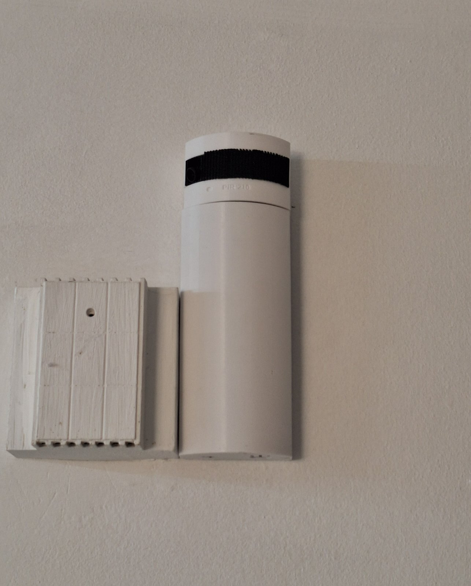<br/><sub>On the wall. The black band hides the lens.</sub></td>
<td align="center">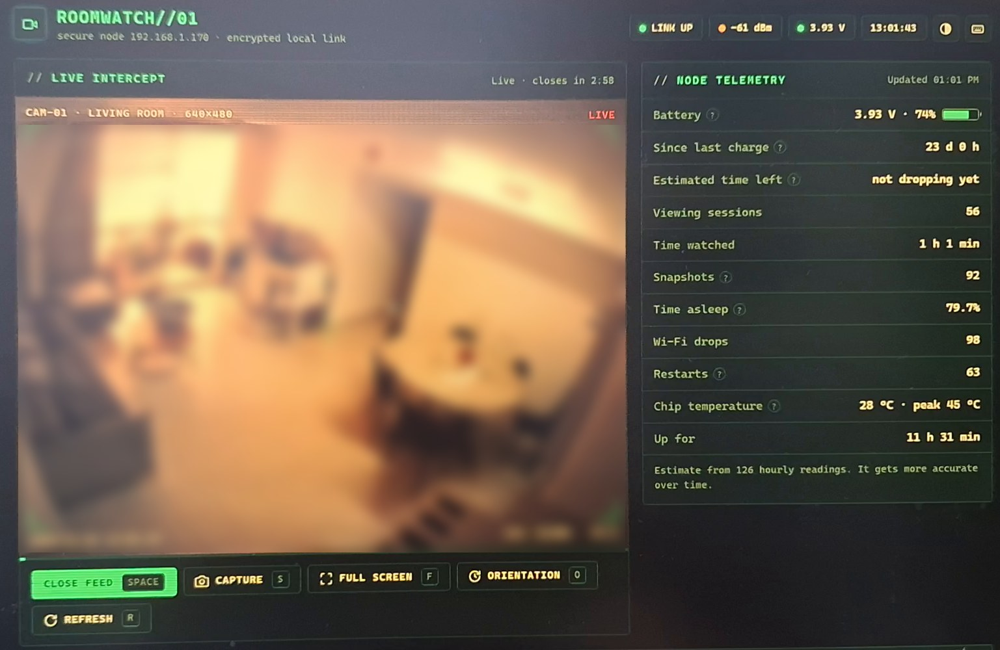<br/><sub>The dashboard: live view (blurred here), battery, sleep share, Wi-Fi and history.<br/>23 days since the last charge, 74% left.</sub></td>
</tr>
</table>

## Features

- **Instant live view.** The camera stays connected to Wi-Fi in light sleep, so opening the page shows a picture right away (MJPEG, VGA, ~24 fps). The stream stops by itself after 3 minutes, so a forgotten tab can't drain the battery.
- **Months per charge.** Idle draw is a few mA (see the [measurements](docs/DEVELOPMENT.md#power-measurements-and-what-moved-the-needle)). It charges over USB-C from the bottom of the case.
- **Local only.** Plain HTTP on your LAN. Nothing leaves the house, and nothing is recorded.
- **Dashboard** in the firmware: battery voltage and %, estimated time left, time asleep, Wi-Fi drops, chip temperature, and an event log (views, snapshots, reboots, charges, hourly battery readings) kept in flash, so it survives a flat battery.
- **Snapshot** as a JPEG, image rotation/mirroring, full screen, keyboard shortcuts.
- **Over-the-air updates** with automatic rollback if a new image can't reach Wi-Fi.
- **Optional Telegram snapshot**: [`tools/telegram_snapshot.py`](tools/telegram_snapshot.py) posts one photo with battery and signal in the caption.

## How it works

```
 Browser ──HTTP──► ESP32-S3 (Wi-Fi STA, modem power-save, automatic light sleep)
                    ├─ /            dashboard (embedded HTML)
                    ├─ /stream      MJPEG, own task, 180 s limit
                    ├─ /capture     one JPEG
                    └─ /api/...     status, events, OTA
                         │
                         └─ OV2640 is powered only while someone is watching:
                            init on demand, then deinit + XCLK pin forced low
```

Two things made the power budget work, and both are hidden in library behaviour:

1. On the ESP32-S3, `esp_camera_deinit()` **does not stop the camera clock** (it is generated by the LCD_CAM peripheral, and deinit only stops LEDC). The sensor kept drawing tens of mA after "stop". The firmware now forces the XCLK pin low itself.
2. The OV2640's software standby **locks up the SCCB bus** until power is removed (a known esp32-camera issue). With the clock stopped, standby isn't needed, so it's skipped.

The full story, with numbers, is in [docs/DEVELOPMENT.md](docs/DEVELOPMENT.md).

## Hardware

| Part | Notes |
|---|---|
| Seeed XIAO ESP32S3 Sense | ESP32-S3, 8 MB flash, 8 MB PSRAM, camera connector, U.FL antenna |
| OV2640 camera, 120°, 75 mm flex | The kit's OV3660 works too. A long flex lets the lens sit in the head of the case. |
| 10,000 mAh 1S LiPo with protection | |
| TP4056 USB-C charger module (with DW01 protection) | Use a plain 5 V USB-A charger. These clones ignore USB-C PD chargers. |
| Slide switch | Between charger and board |
| 2 × 220 kΩ resistors | Battery voltage divider into D0 |
| 4 × M3×8 countersunk, 4 × M3×6 pan head | Self-tapping into the print |
| EVA foam strip | Holds the battery, and the charger against the USB plug |

<p align="center">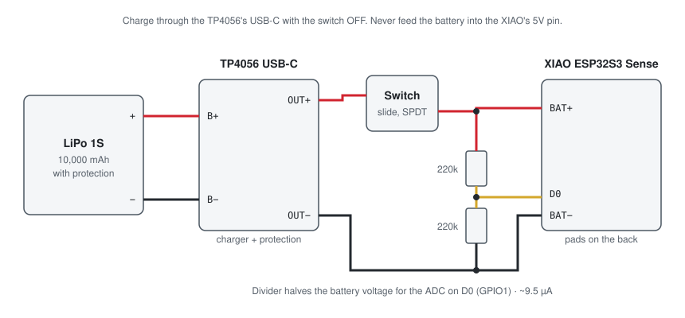</p>

<table>
<tr>
<td align="center">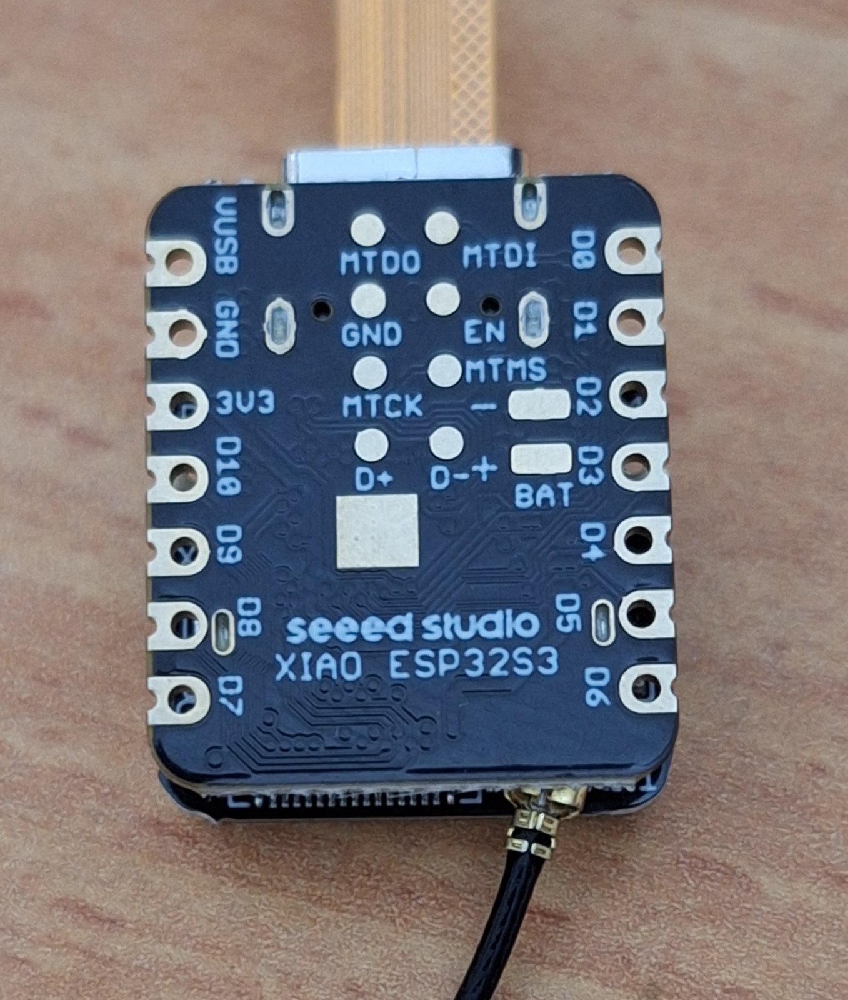<br/><sub>XIAO back: BAT pads</sub></td>
<td align="center">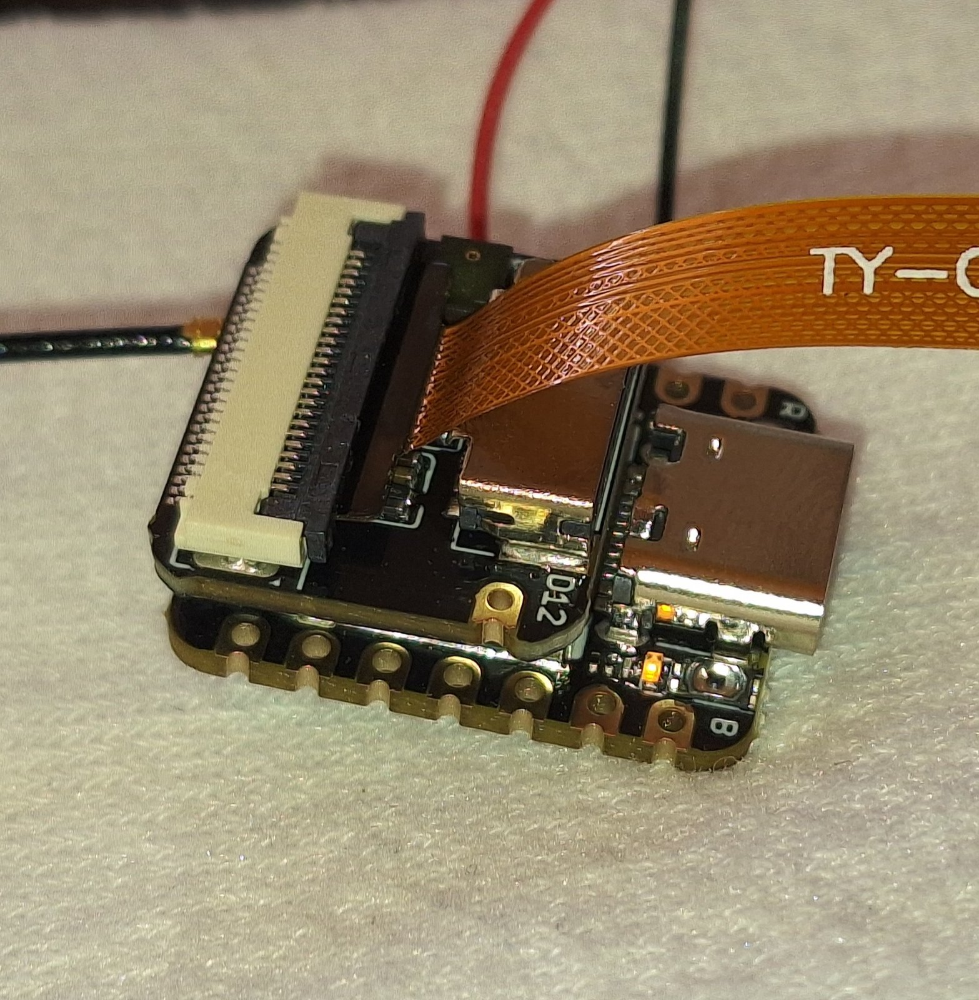<br/><sub>Sense board + camera flex</sub></td>
<td align="center">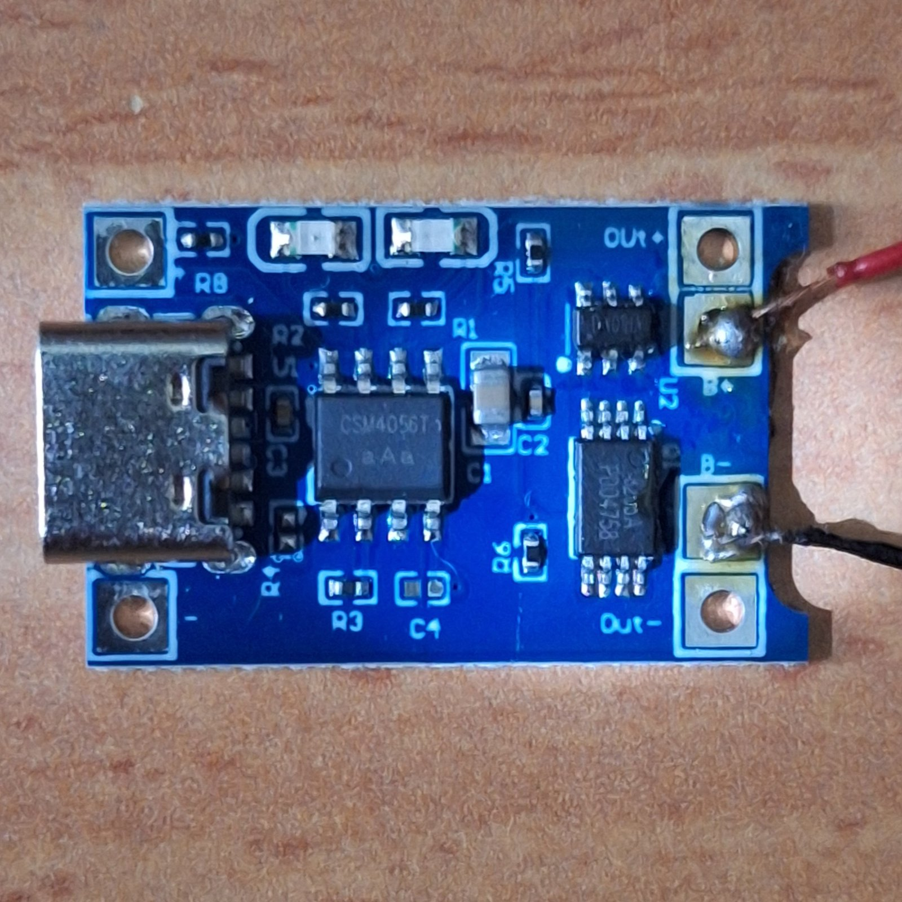<br/><sub>TP4056 charger</sub></td>
<td align="center">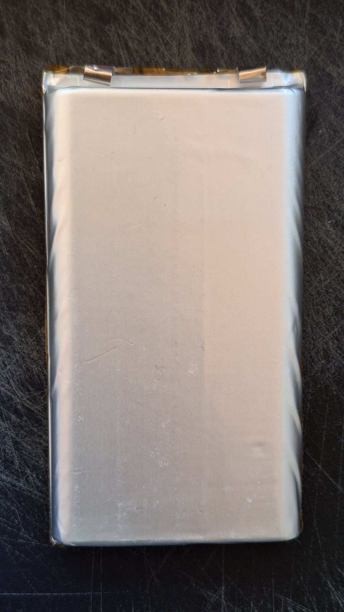<br/><sub>10 Ah LiPo</sub></td>
</tr>
</table>

## Enclosure

<table>
<tr>
<td align="center">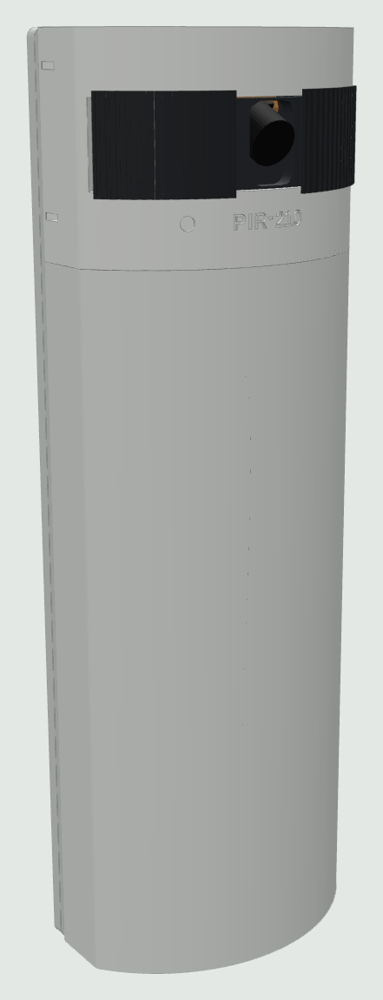<br/><sub>v10 model</sub></td>
<td align="center">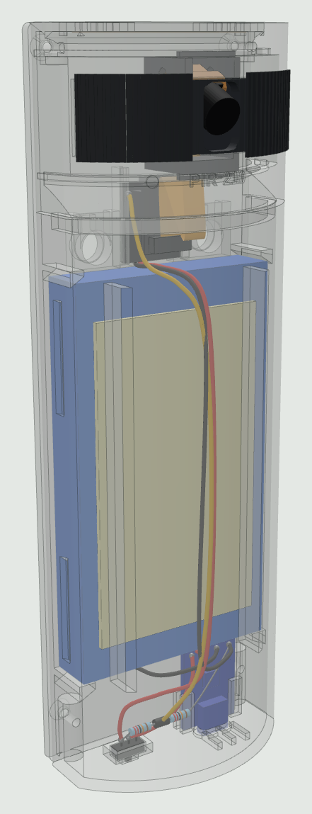<br/><sub>Inside: battery, charger, board, camera</sub></td>
<td align="center">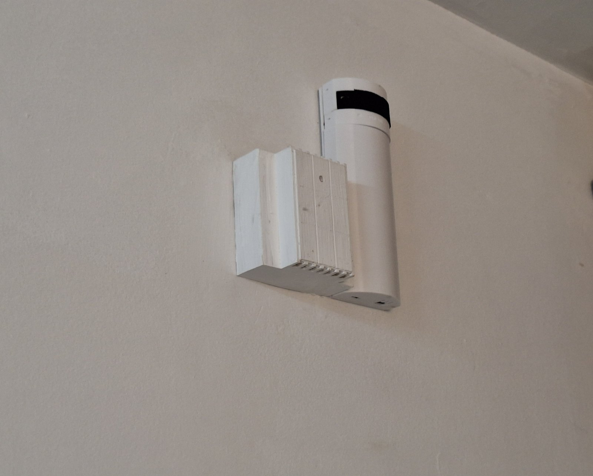<br/><sub>Printed</sub></td>
</tr>
</table>

A tall tower with a flat back for the wall and a rounded front. The lens sits behind a dark slit in the hood. Inside, it rides on a carriage that slides along the arc to aim left and right (±38°), and a rocker tilts it up and down about the lens tip, so the lens never leaves the slit. Small ribbed tiles fill the rest of the slit.

- Model: [`enclosure/camera_enclosure.scad`](enclosure/camera_enclosure.scad) (parametric OpenSCAD)
- Ready-to-print STLs with orientation, colours and settings: [`enclosure/print_package/`](enclosure/print_package/) (PETG recommended, 0.2 mm layers, supports only for the hood)
- Interactive 3D viewer, a single offline file: [`enclosure/viewer/camera_3d.html`](enclosure/viewer/camera_3d.html). Download it and open it in a browser. It includes a step-by-step soldering guide (in Hebrew).
- Camera-mount assembly animation: [`enclosure/viewer/camera_mount.html`](enclosure/viewer/camera_mount.html)
- Earlier designs v2–v9: [`enclosure/archive/`](enclosure/archive/)

> [!WARNING]
> **v10 prints well but is hard to assemble.** The carriage can't enter the hood rails as designed, and the printed STLs predate a fix to the flex slot. Read [what went wrong](docs/DEVELOPMENT.md#enclosure-v10-what-went-wrong) before printing.

## Build and flash

You need [VS Code](https://code.visualstudio.com/) with the [PlatformIO](https://platformio.org/) extension.

1. Copy `include/secrets.example.h` to `include/secrets.h` and fill in your 2.4 GHz Wi-Fi name, password and an OTA key.
2. First flash over USB:
   ```
   pio run -e xiao_esp32s3_sense -t upload
   ```
   If the port doesn't respond (the board may be in light sleep), enter boot mode: hold **B**, tap **R**, release **B**.
3. Find the camera's IP in your router and open `http://<ip>/`. Reserving the address in the router's DHCP settings helps.
4. Later updates over Wi-Fi:
   ```
   pio run -e xiao_esp32s3_sense
   python tools/ota.py [firmware.bin] [host]
   ```
   `CAMERA_HOST` can be set instead of passing the host.

For debugging over USB, use the `debug` env. It never light-sleeps, so the USB console stays alive. With light sleep on, USB stops working while plugged into a PC. That is expected, and on battery everything works.

## Charging

Turn the switch **off**, plug a plain 5 V USB charger into the port at the bottom (USB-A to USB-C cable), and wait for the LED to turn from **red** to **blue**. The dashboard detects the voltage jump and resets "since last charge" by itself.

## Building it

<table>
<tr>
<td align="center">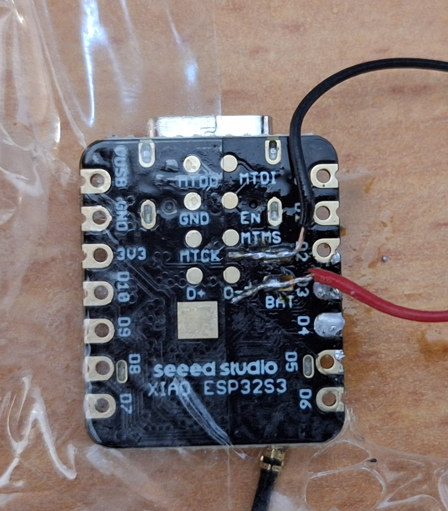<br/><sub>Battery leads on the BAT pads</sub></td>
<td align="center">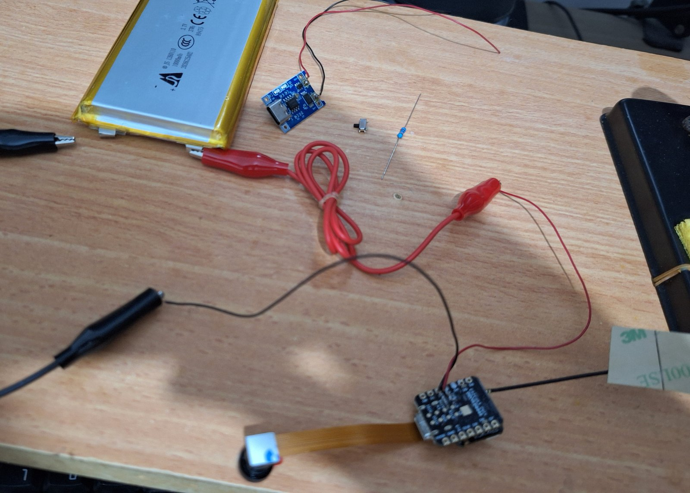<br/><sub>Bench test before the case</sub></td>
<td align="center">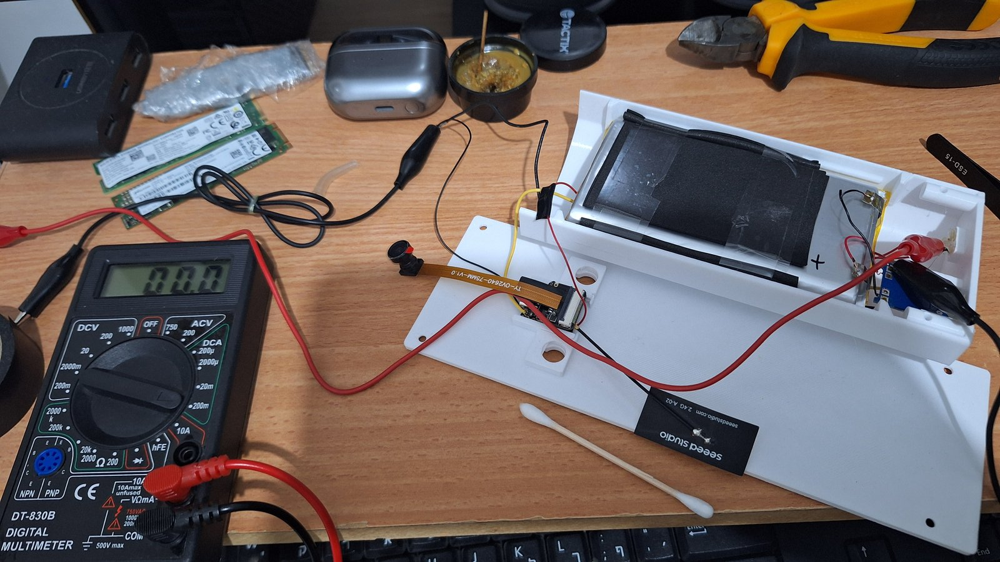<br/><sub>Chasing the idle current</sub></td>
</tr>
<tr>
<td align="center">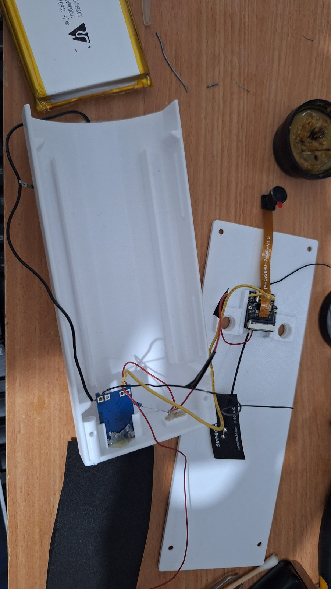<br/><sub>Dry fit</sub></td>
<td align="center">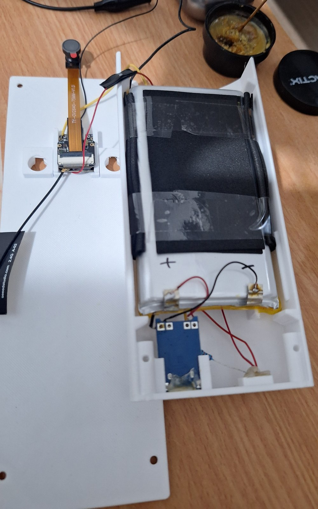<br/><sub>Battery, charger and board in place</sub></td>
<td align="center">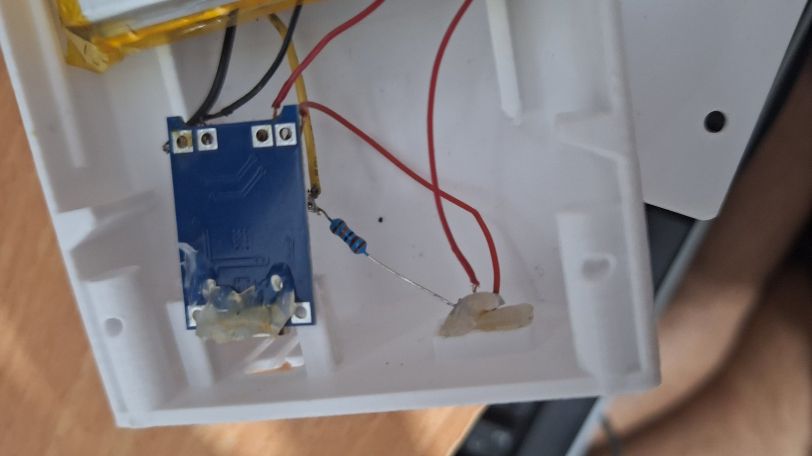<br/><sub>Charger, switch and divider in the base</sub></td>
</tr>
</table>

## Repository layout

```
src/             firmware (main.c, history.c, index.html dashboard)
include/         secrets.example.h  → copy to secrets.h
tools/           ota.py, telegram_snapshot.py
enclosure/       OpenSCAD model, STLs, print package, 3D viewer, older versions
archive/         first firmware (Arduino), kept for reference
docs/            DEVELOPMENT.md (measurements, bugs, lessons) and images
```

<br/>

<a name="-עברית"></a>
<div dir="rtl">

## 🇮🇱 עברית

**RoomWatch** היא מצלמת Wi-Fi קטנה שעובדת על סוללה, לחדר שאין בו שקע. היא נראית כמו גלאי תנועה רגיל על הקיר, ומחזיקה חודשים על סוללה של 10,000mAh. פותחים את הדף בדפדפן בבית ותוך רגע רואים תמונה חיה.

- 🔒 **הכל נשאר בבית.** אין ענן, אין אפליקציה, אין חשבון ואין הקלטה.
- ⚡ **צפייה מיידית.** המצלמה נשארת מחוברת לרשת ב"שינה קלה", ומתעוררת כשמישהו צופה. השידור נסגר לבד אחרי 3 דקות.
- 🔋 **חודשים על טעינה אחת.** אחרי 23 ימים מהטעינה האחרונה נשארו 74%.
- 📊 **לוח בקרה מובנה:** סוללה, זמן שינה, ניתוקי Wi-Fi, טמפרטורה, ויומן אירועים שנשמר גם כשהסוללה נגמרת.
- 🔄 **עדכון תוכנה דרך ה-Wi-Fi**, עם חזרה אוטומטית לגרסה הקודמת אם משהו נכשל.

**החומרה:** ‏XIAO ESP32S3 Sense, מצלמת OV2640 בזווית 120°, סוללת LiPo, מטען TP4056 ומתג. הקופסה מודפסת בתלת-ממד ומתוכננת ב-OpenSCAD. העדשה יושבת מאחורי פס כהה, ואפשר לכוון אותה לצדדים ולמעלה ולמטה.

**התקנה:** מעתיקים את `include/secrets.example.h` ל-`secrets.h`, ממלאים בו את שם הרשת והסיסמה, ומעלים עם PlatformIO. העדכונים הבאים עולים דרך ה-Wi-Fi עם `tools/ota.py`.

**טעינה:** מכבים את המתג ומחברים מטען 5V רגיל (כבל USB-A ל-USB-C). הנורה אדומה בזמן טעינה וכחולה כשהסוללה מלאה.

**חשוב לדעת:** קל להדפיס את גרסה 10 של הקופסה, אבל קשה להרכיב אותה. כל הבעיות והלקחים מתועדים ב-[docs/DEVELOPMENT.md](docs/DEVELOPMENT.md).

</div>
